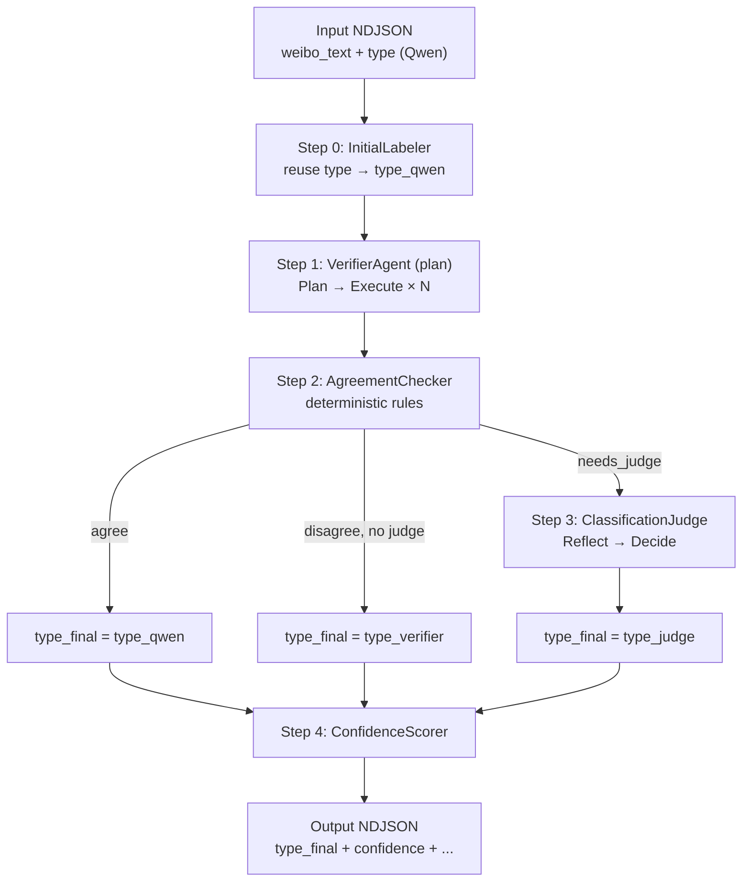
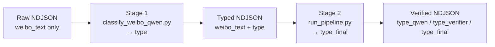

# Weibo Multi-Agent Cross-Validation Pipeline

Two-stage Weibo text classifier (labels 0–6):

| Stage | Script | When to use |
|-------|--------|-------------|
| 1 (optional) | `classify_weibo_qwen.py` | Raw NDJSON without `type` — calls Qwen to write initial labels |
| 2 (core) | `run_pipeline.py` | NDJSON with `type` — multi-agent cross-validation → `type_final` |

**Most users can start at Stage 2.** The labelled dataset is on Figshare (<https://doi.org/10.6084/m9.figshare.32526483>). Its `type` field already holds the Qwen labels, so Stage 2 runs on it directly. See [Data](#data) for the released files and [Reproducing the validation files](#reproducing-the-validation-files) for how the two CSV files were made.

---

## Data

The dataset is deposited on Figshare under CC BY 4.0: <https://doi.org/10.6084/m9.figshare.32526483>. The DOI resolves to the latest version. Data files are not stored in this repository.

| File | Contents |
|------|----------|
| `weibo_light_pollution_high_recall_prefecture_plus_typed.json` | 164,691 geotagged Weibo posts in JSON Lines (NDJSON), one post per line, about 103 MB. Eight fields: `_id`, `user_id` (keyed pseudonym), `create_time` (Beijing Time), `weibo_text` (identifiers masked), `city`, `gender`, `reposts_count` and `type` (Qwen label, 0–6). |
| `validation_sample_labels.csv` | The random sample of 1,000 records checked with this pipeline: `sample_index`, `_id`, `type_qwen`, `type_verifier`, `type_final`, `judge_reviewed`. |
| `reference_sample_labels.csv` | A sample of 1,000 released posts stratified by category (about 143 per category), labelled by two stronger models: `sample_index`, `_id`, `type_qwen`, `type_gpt_5.5_2026_04_23`, `type_gpt_5.4_2026_03_05`. |

Both CSV files are keyed to `_id` in the JSON file. The `type` field holds the Stage 1 label from `qwen-plus`. Labels from the cross-validation were not written back into it; they are given in the two CSV files.

The pipeline reads only `_id`, `weibo_text` and `type`, so the released file can be passed to `run_pipeline.py` unchanged. In `weibo_text`, e-mail addresses, telephone numbers, account handles, @-mentions, the poster's own screen name and check-in places are replaced by placeholders such as `[PHONE]`, `@[USER]` and `[PLACE]`. The released labels were assigned to the unmasked text, so labels produced again from the masked text may differ for a few posts.

Please do not try to identify or contact users, and report results as totals or averages over many posts. The Data Descriptor gives the full guidance on responsible use.

---

## 1. Quick Start

```bash
cd Agent_classifier
# Configure API keys in .env (see Section 14)
```

### Stage 1 — Qwen initial labeling (optional)

Only needed for **new, unlabeled** NDJSON. Writes a numeric `type` field (0–6) per record via DashScope/Qwen.

```bash
# Full run (supports --resume for interrupted jobs)
python classify_weibo_qwen.py \
  --input weibo_light_pollution_high_recall_prefecture_plus.json \
  --output weibo_light_pollution_high_recall_prefecture_plus_typed.json \
  --model qwen-plus \
  --batch-size 200 \
  --resume

# Quick test on 100 records
python classify_weibo_qwen.py \
  --input weibo_light_pollution_high_recall_prefecture_plus.json \
  --output test_typed.json \
  --limit 100
```

> **Note:** We only release `weibo_light_pollution_high_recall_prefecture_plus_typed.json` (with Qwen `type` labels; see [Data](#data)). The released labels were produced with `--model qwen-plus --batch-size 200`. The Stage 1 example uses `weibo_light_pollution_high_recall_prefecture_plus.json` as a placeholder for the **untyped** input — you can derive it by removing the `type` field from each record in the typed file, then run `classify_weibo_qwen.py` for initial labeling. **The core of this repo is Stage 2:** multi-agent cross-validation of labels using **Plan-and-Solve** (Verifier) and **Reflection** (Judge) paradigms.

| Flag | Default | Description |
|------|---------|-------------|
| `--input` | `weibo_light_pollution_high_recall_prefecture_plus.json` | Input NDJSON |
| `--output` | `<input_stem>_typed.json` | Output NDJSON with `type` |
| `--api-key` | — | DashScope API key (or set `QWEN_API_KEY`) |
| `--model` | `qwen-plus` | Qwen model name |
| `--batch-size` | `20` | Records per API call |
| `--resume` | off | Skip rows already written to output |
| `--limit` | none | Process only the first N records (testing) |

### Stage 2 — Multi-agent cross-validation (core)

Reads existing `type` as `type_qwen`, runs independent Verifier + optional Judge, outputs `type_final`, `confidence`, and `needs_manual_review`. Does **not** call Qwen unless you pass `--no-reuse-qwen-type`.

```bash
# Default smoke test (10 records)
python run_pipeline.py \
  --input weibo_light_pollution_high_recall_prefecture_plus_typed.json \
  --output weibo_pipeline_verified.json \
  --limit 10

# Plan-and-Solve verifier + judge on disagreement
python run_pipeline.py \
  --input weibo_light_pollution_high_recall_prefecture_plus_typed.json \
  --output weibo_pipeline_verified.json \
  --verifier-mode plan \
  --judge-policy disagree_only \
  --limit 10

# Random sample + stats (type_qwen vs type_final)
python run_pipeline.py \
  --input weibo_light_pollution_high_recall_prefecture_plus_typed.json \
  --random-sample 100 \
  --seed 42 \
  --stats-output pipeline_stats.json \
  --verifier-mode plan
```

| Flag | Default | Description |
|------|---------|-------------|
| `--verifier-mode plan` | `single` | `plan` = Plan-and-Solve; `single` = one-shot classification |
| `--judge-policy disagree_only` | `disagree_only` | Run Judge only when Qwen ≠ Verifier |
| `--judge-policy full` | — | Also run Judge on boundary / ambiguous pairs |
| `--reuse-qwen-type` | `true` | Reuse input `type`; do not call Qwen again |

**Estimated API calls (Plan mode, per record):** ~5 if Qwen = Verifier; ~7 if Judge is triggered (1 Plan + 4 Execute + Reflect + Decide).

---

## Reproducing the validation files

The Data Descriptor reports two checks of the released labels. Both can be re-run from the Figshare files.

### Random sample (`validation_sample_labels.csv`)

The sample was drawn with `run_pipeline.py --random-sample 1000 --seed 42` from all 242,137 labelled records, before duplicate copies of posts were removed. Each sampled record was then matched to its post in the released file; two sampled records were copies of the same post, so the file lists 999 distinct `_id` values. Running `--random-sample` on the released file draws a different sample. To re-run the Verifier and Judge on the same posts, select them by `_id`:

```python
import csv, json
ids = {r["_id"] for r in csv.DictReader(open("validation_sample_labels.csv", encoding="utf-8"))}
with open("weibo_light_pollution_high_recall_prefecture_plus_typed.json", encoding="utf-8") as src, \
     open("validation_sample.json", "w", encoding="utf-8") as out:
    for line in src:
        if json.loads(line)["_id"] in ids:
            out.write(line)
```

```bash
python run_pipeline.py \
  --input validation_sample.json \
  --output validation_sample_verified.json \
  --verifier-mode plan \
  --judge-policy disagree_only
```

The published labels used `gpt-5.4-mini` as both Verifier and Judge (see [Environment Variables](#14-environment-variables)). Hosted models can change between runs and snapshots, so expect labels close to the published ones rather than identical.

### Stratified sample (`reference_sample_labels.csv`)

`draw_reference_sample.py` draws the sample from the released file, with about 143 posts per category and seed 43. It reproduces the published `_id` list exactly, in the same order, and also writes each post's sampling weight (posts in its category divided by posts sampled from it), which is needed to weight agreement back to the whole dataset. `label_reference_sample.py` then sends each post to a reference model with the same category instructions as Stage 1, one post per request, without the Qwen label.

```bash
python draw_reference_sample.py \
  --release weibo_light_pollution_high_recall_prefecture_plus_typed.json \
  --out reference_sample_stratified.jsonl

export OPENAI_API_KEY="..."
python label_reference_sample.py --input reference_sample_stratified.jsonl --model gpt-5.5
python label_reference_sample.py --input reference_sample_stratified.jsonl --model gpt-5.4
```

Each run writes a JSON Lines file with the model's label in `type_ref`. The published labels came from the 2026-04-23 snapshot of `gpt-5.5` and the 2026-03-05 snapshot of `gpt-5.4`; pass a snapshot name as `--model` to use a fixed version.

---

The sections below document design goals, label schema, architecture, prompts, and module details.

---

## 2. Design Goals

For each Weibo post (`weibo_text`), the pipeline **does not re-run Qwen** by default. Instead it:

1. **Reuses** the existing `type` field in the input NDJSON as the Qwen initial label (`type_qwen`)
2. Runs an **independent Verifier** (OpenAI-compatible model) that **never sees** the Qwen label
3. Uses **AgreementChecker** to compare the two labels
4. If they disagree (or other rules fire under `full` policy), **ClassificationJudge** performs Reflection-style adjudication
5. Uses **ConfidenceScorer** to output confidence and a manual-review flag

All three classification agents share the same label semantics (0–6 definitions + priority rules) from:

`agents/prompts/classification.py` → `LABEL_DEFINITIONS_AND_RULES`

---

## 3. Label Schema (0–6)

| Label | Theme | Category |
|-------|-------|----------|
| 0 | Light | Direct light complaint or harm |
| 1 | Light | Urban night illumination |
| 2 | Light | Light policy, technology, ecology, or astronomy |
| 3 | Sleep | Direct insomnia or unable to sleep |
| 4 | Sleep | Chronic sleep disorder, treatment, or help-seeking |
| 5 | Sleep | Causes or impacts of poor sleep |
| 6 | Unrelated | Unrelated keyword noise |

Category names follow the Data Descriptor. Full definitions and priority rules live in `LABEL_DEFINITIONS_AND_RULES` inside `agents/prompts/classification.py`; the prompts are kept exactly as they were run, and there the two themes are called "light pollution" and "insomnia".

---

## 4. Overall Architecture



### 4.1 Agent Roles

| Agent | File | Calls LLM? | Role |
|-------|------|------------|------|
| InitialLabeler | `agents/InitialLabeler.py` | No (default) | Read cached Qwen `type` |
| VerifierAgent | `agents/VerifierAgent.py` | Yes | Independent verification (Plan-and-Solve) |
| AgreementChecker | `agents/AgreementChecker.py` | No | Agreement rules |
| ClassificationJudge | `agents/ClassificationJudge.py` | Yes | Dispute adjudication (Reflection) |
| ConfidenceScorer | `agents/ConfidenceScorer.py` | No | Confidence / manual review |

### 4.2 End-to-End Workflow



| Stage | Script | Input | Output field | Purpose |
|-------|--------|-------|--------------|---------|
| 1 (optional) | `classify_weibo_qwen.py` | NDJSON without `type` | `type` | Qwen initial label |
| 2 (core) | `run_pipeline.py` | NDJSON with `type` | `type_final` (+ audit fields) | Multi-agent cross-validation |

---

## 5. Step 0: InitialLabeler (Reuse Qwen Label)

**File**: `InitialLabeler.py`  
**Default**: no LLM call; reads `type` from the input record.

```python
LabelPrediction.from_qwen_type(record.type)
# → label = type
# → rationale = "" (empty)
# → cached_without_rationale = True
```

### 5.1 Re-running Qwen (Non-default)

- CLI: `--no-reuse-qwen-type`
- System: `CLASSIFICATION_SYSTEM_PROMPT` (`prompts/classification.py`)
- User: `build_single_classify_user_prompt(weibo_text)`

---

## 6. Step 1: VerifierAgent — Plan-and-Solve

**File**: `VerifierAgent.py`  
**Mode**: `_verify_plan_and_solve()` when `--verifier-mode plan`

The Verifier is **independent** of Qwen: the user prompt contains only `weibo_text`, **not** Qwen's `type`.

### 6.1 Shared System Prompt

Every Verifier LLM call (Plan + each Execute step) uses:

**`VERIFIER_SYSTEM_PROMPT`** (`prompts/classification.py`)

```
Role: independent verifier
Content: LABEL_DEFINITIONS_AND_RULES (full 0–6 + priority rules)
Output contract: final step returns {"type": ..., "rationale": "..."}
```

### 6.2 Phase A — Plan

| Item | Content |
|------|---------|
| User template | `VERIFIER_PLANNER_PROMPT` (`prompts/verifier.py`) |
| Input | `build_verifier_question(weibo_text)` |
| Expected output | Python list of 3–5 step strings |
| Parsing | `parse_plan_from_response()` — supports `` ```python ``, bare JSON lists, etc. |

**`build_verifier_question` structure**:

```
Independently classify the following Weibo post using ONLY `weibo_text`.
Do not use any prior label from another classifier.

weibo_text:
<text>

Your final step must output valid JSON only:
{"type": <0-6>, "rationale": "<brief reason>"}
```

**Example plan output** (visible in terminal):

```python
[
  "Step 1: Read only weibo_text, ignore location metadata.",
  "Step 2: Identify insomnia vs light-pollution signals.",
  "Step 3: Apply priority rules.",
  "Step 4: Output final JSON label."
]
```

### 6.3 Phase B — Solve (Step-by-Step Execution)

Each plan step triggers one LLM call:

| Item | Content |
|------|---------|
| User template | `VERIFIER_EXECUTOR_PROMPT` (`prompts/verifier.py`) |
| Injected fields | `question`, `plan`, `history`, `current_step` |
| System | same `VERIFIER_SYSTEM_PROMPT` |

Execute loop:

```
history = ""
for step in plan:
    response = LLM(EXECUTOR_PROMPT + current_step)
    history += step + response
final_response = last step's response
```

- **Intermediate steps**: free-text reasoning (not JSON)
- **Final step**: should output `{"type": int, "rationale": str}`

Parsing: `extract_json_object(final_response)` → `type_verifier`, `verifier_rationale`

### 6.4 Verifier Output

| Field | Meaning |
|-------|---------|
| `type_verifier` | Final Plan-and-Solve label |
| `verifier_rationale` | Verifier rationale |

In-memory trace (not written to NDJSON by default): `trace.plan`, `trace.steps[]`

---

## 7. Step 2: AgreementChecker (Deterministic Rules)

**File**: `AgreementChecker.py`  
**No LLM calls**

### 7.1 `disagree_only` (Default)

| Condition | needs_judge |
|-----------|-------------|
| `type_qwen != type_verifier` | **True** |
| `type_qwen == type_verifier` | **False** |

### 7.2 `full` Policy — Additional Judge Triggers

- Qwen or Verifier label ∈ `{2, 5}` (boundary labels)
- Label pair ∈ `AMBIGUOUS_PAIRS` (e.g. (3,5), (0,1), …)
- Rationale contains uncertainty tokens ("uncertain", "maybe", "可能", …)

---

## 8. Step 3: ClassificationJudge — Reflect & Decide

**File**: `ClassificationJudge.py`  
**Runs only when** `AgreementChecker.needs_judge == True`

Judge is a **simplified Reflection pattern** :

| Classic Reflection step | Judge equivalent |
|-------------------------|------------------|
| Initial attempt | Qwen + Verifier results already exist |
| Reflect (critique) | `JUDGE_REFLECT_PROMPT` → `critique` |
| Refine (improve) | `JUDGE_DECISION_PROMPT` → final JSON label |

### 8.1 Shared System Prompt

**`JUDGE_SYSTEM_PROMPT`** (`prompts/classification.py`)

```
Role: strict adjudication expert
Content: same LABEL_DEFINITIONS_AND_RULES
Output contract: decision phase returns JSON
```

### 8.2 Phase A — Reflect (Critique, No JSON)

**User template**: `JUDGE_REFLECT_PROMPT` (`prompts/judge.py`)

**Inputs**:

```
# Weibo Text
{classifier_a_block}   ← Qwen: label + rationale (or NOT AVAILABLE)
{classifier_b_block}   ← Verifier: label + rationale
```

For cached Qwen labels, `format_classifier_context()` writes:

```
Rationale: NOT AVAILABLE. This is a cached prior label...
Re-evaluate whether this label fits the Weibo text...
```

**Analysis requirements** (4 items in prompt):

1. Which text signals support each label under the official definitions?
2. Which label better matches the central topic and priority rules?
3. Is either label clearly wrong due to username noise, daytime sunlight, metaphor, or weak keyword matching?
4. If Classifier A has no rationale, independently re-evaluate its numeric label from the text.

**Output**: free-text `critique` (no JSON)

### 8.3 Phase B — Decide (Final Ruling)

**User template**: `JUDGE_DECISION_PROMPT` (`prompts/judge.py`)

**Additional input**: `{critique}` from the Reflect phase

**Output**:

```json
{"type": 3, "rationale": "..."}
```

→ `type_judge`, `judge_rationale`

### 8.4 Relationship Between type_judge and type_final

When Judge runs:

```
type_final = type_judge
pipeline_agreement = "judge_resolved"
```

**`type_judge` equals `type_final`**; `type_judge` appears only when Judge was invoked.

---

## 9. Step 4: ConfidenceScorer + Final Output

**File**: `ConfidenceScorer.py`

### 9.1 type_final Decision Table

| pipeline_agreement | Condition | type_final |
|--------------------|-----------|------------|
| `agree` | Qwen = Verifier, Judge skipped | `type_qwen` |
| `judge_resolved` | Judge ran | `type_judge` |
| `disagree_unresolved` | Disagree, Judge skipped (rare) | `type_verifier` |

### 9.2 Output NDJSON Fields

| Field | Description |
|-------|-------------|
| `type` | Original Qwen label (preserved from input) |
| `type_qwen` | Same as `type` (pipeline view) |
| `type_verifier` | Verifier Plan-and-Solve result |
| `type_judge` | Judge result (if present) |
| **`type_final`** | **Authoritative final label** |
| `verifier_rationale` | Verifier rationale |
| `judge_rationale` | Judge rationale (if present) |
| `confidence` | 0–1 |
| `needs_manual_review` | Whether human review is recommended |
| `pipeline_agreement` | `agree` / `judge_resolved` / `disagree_unresolved` |

---

## 10. Concrete Example (Plan + disagree_only)

**Input**:

```json
{
  "weibo_text": "连续几天失眠胃不舒服，终于去看了医生～...",
  "type": 4
}
```

*(Translation: "Insomnia for several days, stomach discomfort, finally saw a doctor…")*

### 10.1 Step 0 — Reuse Qwen

```
type_qwen = 4
rationale = (empty, cached)
```

### 10.2 Step 1 — Verifier Plan-and-Solve

**LLM call 1 (Plan)**  
System: `VERIFIER_SYSTEM_PROMPT`  
User: `VERIFIER_PLANNER_PROMPT` + question

→ Plan: `[identify insomnia signals, check clinical/treatment focus, …, output JSON]`

**LLM calls 2–5 (Execute)**  
System: `VERIFIER_SYSTEM_PROMPT`  
User: `VERIFIER_EXECUTOR_PROMPT` + history

→ Final step: `{"type": 3, "rationale": "Direct self-report of several days of insomnia..."}`

```
type_verifier = 3
```

### 10.3 Step 2 — AgreementChecker

```
4 != 3  →  needs_judge = True
```

### 10.4 Step 3 — Judge

**LLM call 6 (Reflect)**  
System: `JUDGE_SYSTEM_PROMPT`  
User: `JUDGE_REFLECT_PROMPT` + weibo + Qwen(4, no rationale) + Verifier(3, with rationale)

→ critique: "Label 4 is plausible due to doctor visit, but treatment focus is stomach not insomnia… label 3 is more precise."

**LLM call 7 (Decide)**  
User: `JUDGE_DECISION_PROMPT` + critique

→ `{"type": 3, "rationale": "..."}`

```
type_judge = 3
type_final = 3
```

### 10.5 Terminal Line

```
[4] ... qwen=4 verifier=3 final=3 conf=0.78 review=True
```

---

## 11. Prompt File Index

| Purpose | File | Symbol |
|---------|------|--------|
| Shared label definitions | `prompts/classification.py` | `LABEL_DEFINITIONS_AND_RULES` |
| Qwen initial system | `prompts/classification.py` | `CLASSIFICATION_SYSTEM_PROMPT` |
| Verifier system | `prompts/classification.py` | `VERIFIER_SYSTEM_PROMPT` |
| Judge system | `prompts/classification.py` | `JUDGE_SYSTEM_PROMPT` |
| Verifier task question | `prompts/classification.py` | `build_verifier_question()` |
| Verifier Plan user | `prompts/verifier.py` | `VERIFIER_PLANNER_PROMPT` |
| Verifier Execute user | `prompts/verifier.py` | `VERIFIER_EXECUTOR_PROMPT` |
| Judge Reflect user | `prompts/judge.py` | `JUDGE_REFLECT_PROMPT` |
| Judge Decide user | `prompts/judge.py` | `JUDGE_DECISION_PROMPT` |
| Classifier context blocks | `prompts/classification.py` | `format_classifier_context()` |

---

## 12. Core Cross-Validation Principles

1. **Unified semantics**: Verifier and Judge system prompts embed the same `LABEL_DEFINITIONS_AND_RULES`
2. **Verifier independence**: Plan/Execute never sees Qwen's `type`
3. **No Qwen rationale**: Judge must re-read the text under the definitions; it cannot blindly trust Qwen's numeric label
4. **Plan-and-Solve ≠ Reflection**:
   - Verifier: decompose into a plan, solve step-by-step → `type_verifier`
   - Judge: reflect (critique), then decide → `type_final`
5. **Final label**: always use **`type_final`**; compare against Qwen with `type_qwen` vs `type_final`

---

## 13. Directory Layout

```
Agent_classifier/
├── README.md                    ← this document
├── run_pipeline.py              ← CLI entry point
├── classify_weibo_qwen.py       ← Stage 1 Qwen batch labeling
├── draw_reference_sample.py     ← stratified reference sample (seed 43)
├── label_reference_sample.py    ← reference-model labels for that sample
├── .env.example                 ← copy to .env and add your keys
├── .gitignore                   ← ignores .env and data files
├── *.json                       ← input/output data (gitignored)
└── agents/                      ← core multi-agent modules
    ├── __init__.py
    ├── PipelineOrchestrator.py  ← orchestration
    ├── InitialLabeler.py        ← Step 0
    ├── VerifierAgent.py         ← Step 1 (plan/single)
    ├── AgreementChecker.py      ← Step 2
    ├── ClassificationJudge.py   ← Step 3
    ├── ConfidenceScorer.py      ← Step 4
    ├── pipeline_stats.py        ← random sampling + stats
    ├── schemas.py               ← data structures
    ├── Language_Agent.py        ← LLM client
    ├── Memory.py
    └── prompts/
        ├── classification.py    ← shared labels + system prompts
        ├── verifier.py          ← Plan / Execute prompts
        └── judge.py             ← Reflect / Decide prompts
```

---

## 14. Environment Variables

Copy `.env.example` to `.env` and fill in your keys. `.env` is listed in `.gitignore`, so keys stay out of the repository. `run_pipeline.py` reads it:

```env
VERIFIER_MODEL_ID="gpt-5.4-mini"
VERIFIER_API_KEY="${OPENAI_API_KEY}"
VERIFIER_BASE_URL="https://api.openai.com/v1"

JUDGE_MODEL_ID="gpt-5.4-mini"
JUDGE_API_KEY="${OPENAI_API_KEY}"
JUDGE_BASE_URL="https://api.openai.com/v1"
```

Verifier and Judge may share the same API account; `Language_Agent` shares rate-limit state across clients on the same key.

`classify_weibo_qwen.py` reads `QWEN_API_KEY` and `label_reference_sample.py` reads `OPENAI_API_KEY` from the environment.

---

## Citation

If you use the data or code, please cite the Figshare record (<https://doi.org/10.6084/m9.figshare.32526483>) and the Data Descriptor "An LLM-Labelled Weibo Dataset of Nighttime Lighting and Sleep-Related Expressions in China" (under review).
