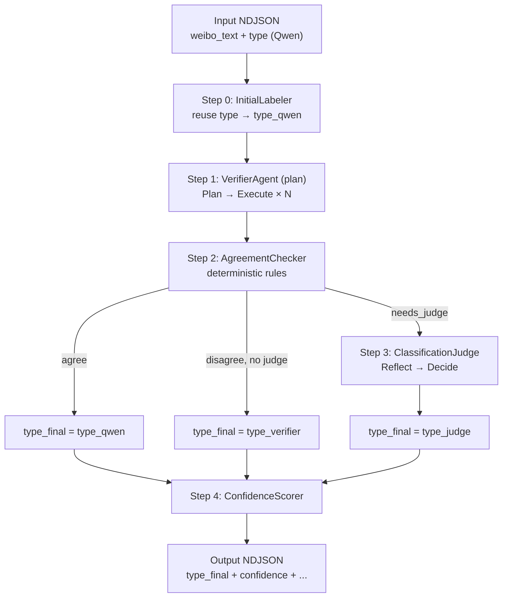
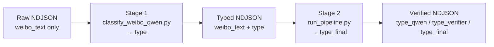

# Weibo Multi-Agent Cross-Validation Pipeline

This project has **two stages**:

1. **Stage 1 — Qwen initial labeling** (`classify_weibo_qwen.py`): batch-classify raw Weibo NDJSON and write a numeric `type` field (0–6) per record.
2. **Stage 2 — Multi-agent cross-validation** (`run_pipeline.py`): reuse the Qwen `type` as `type_qwen`, then run an independent Verifier, AgreementChecker, optional Judge, and ConfidenceScorer to produce an authoritative `type_final`.

**The bundled dataset already includes Qwen labels** (e.g. `weibo_light_pollution_high_recall_prefecture_plus_typed.json` with a `type` column). You can skip Stage 1 and run `run_pipeline.py` directly. Use `classify_weibo_qwen.py` only when you have **new, unlabeled** NDJSON or want to **re-label** from scratch.

The rest of this document focuses on **Stage 2** in **Plan mode** (`--verifier-mode plan`): system prompts, per-module user prompts, Verifier Plan-and-Solve, and Judge Reflection adjudication.

---

## 1. Design Goals

For each Weibo post (`weibo_text`), the pipeline **does not re-run Qwen** by default. Instead it:

1. **Reuses** the existing `type` field in the input NDJSON as the Qwen initial label (`type_qwen`)
2. Runs an **independent Verifier** (OpenAI-compatible model) that **never sees** the Qwen label
3. Uses **AgreementChecker** to compare the two labels
4. If they disagree (or other rules fire under `full` policy), **ClassificationJudge** performs Reflection-style adjudication
5. Uses **ConfidenceScorer** to output confidence and a manual-review flag

All three classification agents share the same label semantics (0–6 definitions + priority rules) from:

`agents/prompts/classification.py` → `LABEL_DEFINITIONS_AND_RULES`

---

## 2. Label Schema (0–6)

| Label | Meaning |
|-------|---------|
| 0 | Light pollution — direct complaint or harm |
| 1 | Light pollution — urban night-light scene / strong artificial illumination |
| 2 | Light pollution — governance / technology / ecology / measurement / astronomy |
| 3 | Insomnia — direct self-reported sleeplessness |
| 4 | Insomnia — chronic / clinical / treatment / help-seeking |
| 5 | Insomnia — causes / consequences / emotional or functional impact |
| 6 | Unrelated |

Full definitions and priority rules live in `LABEL_DEFINITIONS_AND_RULES` inside `prompts/classification.py`.

---

## 3. Overall Architecture



### 3.1 Agent Roles

| Agent | File | Calls LLM? | Role |
|-------|------|------------|------|
| InitialLabeler | `agents/InitialLabeler.py` | No (default) | Read cached Qwen `type` |
| VerifierAgent | `agents/VerifierAgent.py` | Yes | Independent verification (Plan-and-Solve) |
| AgreementChecker | `agents/AgreementChecker.py` | No | Agreement rules |
| ClassificationJudge | `agents/ClassificationJudge.py` | Yes | Dispute adjudication (Reflection) |
| ConfidenceScorer | `agents/ConfidenceScorer.py` | No | Confidence / manual review |

### 3.2 End-to-End Workflow



| Stage | Script | Input | Output field | Purpose |
|-------|--------|-------|--------------|---------|
| 1 (optional) | `classify_weibo_qwen.py` | NDJSON without `type` | `type` | Qwen initial label |
| 2 (core) | `run_pipeline.py` | NDJSON with `type` | `type_final` (+ audit fields) | Multi-agent cross-validation |

---

## 4. Running the Pipeline

### 4.0 Stage 1 — Qwen initial labeling (`classify_weibo_qwen.py`)

Use this script when input records **do not yet have** a `type` field, or when you want to regenerate Qwen labels on new data.

It reads NDJSON (`weibo_text` per row), calls Qwen (DashScope-compatible API), and **appends** `"type": 0–6` to each JSON object. Label semantics match Section 2.

```bash
cd Agent_classifier

# Full run (supports --resume for interrupted jobs)
python classify_weibo_qwen.py \
  --input weibo_light_pollution_high_recall_prefecture_plus.json \
  --output weibo_light_pollution_high_recall_prefecture_plus_typed.json \
  --model qwen-plus \
  --batch-size 200 \
  --resume

# Quick validation on a small sample
python classify_weibo_qwen.py \
  --input weibo_light_pollution_high_recall_prefecture_plus.json \
  --output test_typed.json \
  --limit 100
```

| Flag | Default | Description |
|------|---------|-------------|
| `--input` | `weibo_light_pollution_high_recall_prefecture_plus.json` | Input NDJSON |
| `--output` | `<input_stem>_typed.json` | Output NDJSON with `type` |
| `--api-key` | — | DashScope API key (or set `QWEN_API_KEY`) |
| `--model` | `qwen-plus` | Qwen model name |
| `--batch-size` | `20` | Records per API call |
| `--resume` | off | Skip rows already written to output |
| `--limit` | none | Process only the first N records (testing) |

**Already labeled?** If your JSON already contains `type` (as in `weibo_light_pollution_high_recall_prefecture_plus_typed.json`), go straight to Stage 2 below — `run_pipeline.py` reads that field as `type_qwen` by default (`--reuse-qwen-type`).

### 4.1 Stage 2 — Multi-agent cross-validation (`run_pipeline.py`)

This is the **core** of the project: independent Verifier + agreement rules + optional Judge, producing `type_final`, `confidence`, and `needs_manual_review`. It does **not** call Qwen unless you pass `--no-reuse-qwen-type`.

```bash
cd Agent_classifier

python run_pipeline.py \
  --input weibo_light_pollution_high_recall_prefecture_plus_typed.json \
  --output weibo_pipeline_verified.json \
  --verifier-mode plan \
  --judge-policy disagree_only \
  --limit 10
```

Random sampling + statistics (`type_qwen` vs `type_final`):

```bash
python run_pipeline.py \
  --input weibo_light_pollution_high_recall_prefecture_plus_typed.json \
  --random-sample 100 \
  --seed 42 \
  --stats-output pipeline_stats.json \
  --verifier-mode plan
```

### 4.2 Key CLI Flags (Stage 2)

| Flag | Default | Description |
|------|---------|-------------|
| `--verifier-mode plan` | `single` | `plan` = Plan-and-Solve; `single` = one-shot classification |
| `--judge-policy disagree_only` | `disagree_only` | Run Judge only when Qwen ≠ Verifier |
| `--judge-policy full` | — | Also run Judge on boundary / ambiguous pairs |
| `--reuse-qwen-type` | `true` | Reuse input `type`; do not call Qwen again |

### 4.3 Estimated API Calls (Plan Mode)

Assume a 4-step plan and Judge is triggered:

| Stage | Calls |
|-------|-------|
| Verifier Plan | 1 |
| Verifier Execute | 4 (varies with plan length) |
| Judge Reflect | 1 |
| Judge Decide | 1 |
| **Total** | **~7 per record** |

If Qwen = Verifier under `disagree_only`: **~5 per record** (no Judge).

---

## 5. Step 0: InitialLabeler (Reuse Qwen Label)

**File**: `InitialLabeler.py`  
**Default**: no LLM call; reads `type` from the input record.

```python
LabelPrediction.from_qwen_type(record.type)
# → label = type
# → rationale = "" (empty)
# → cached_without_rationale = True
```

### 5.1 Re-running Qwen (Non-default)

- CLI: `--no-reuse-qwen-type`
- System: `CLASSIFICATION_SYSTEM_PROMPT` (`prompts/classification.py`)
- User: `build_single_classify_user_prompt(weibo_text)`

---

## 6. Step 1: VerifierAgent — Plan-and-Solve

**File**: `VerifierAgent.py`  
**Mode**: `_verify_plan_and_solve()` when `--verifier-mode plan`

The Verifier is **independent** of Qwen: the user prompt contains only `weibo_text`, **not** Qwen's `type`.

### 6.1 Shared System Prompt

Every Verifier LLM call (Plan + each Execute step) uses:

**`VERIFIER_SYSTEM_PROMPT`** (`prompts/classification.py`)

```
Role: independent verifier
Content: LABEL_DEFINITIONS_AND_RULES (full 0–6 + priority rules)
Output contract: final step returns {"type": ..., "rationale": "..."}
```

### 6.2 Phase A — Plan

| Item | Content |
|------|---------|
| User template | `VERIFIER_PLANNER_PROMPT` (`prompts/verifier.py`) |
| Input | `build_verifier_question(weibo_text)` |
| Expected output | Python list of 3–5 step strings |
| Parsing | `parse_plan_from_response()` — supports `` ```python ``, bare JSON lists, etc. |

**`build_verifier_question` structure**:

```
Independently classify the following Weibo post using ONLY `weibo_text`.
Do not use any prior label from another classifier.

weibo_text:
<text>

Your final step must output valid JSON only:
{"type": <0-6>, "rationale": "<brief reason>"}
```

**Example plan output** (visible in terminal):

```python
[
  "Step 1: Read only weibo_text, ignore location metadata.",
  "Step 2: Identify insomnia vs light-pollution signals.",
  "Step 3: Apply priority rules.",
  "Step 4: Output final JSON label."
]
```

### 6.3 Phase B — Solve (Step-by-Step Execution)

Each plan step triggers one LLM call:

| Item | Content |
|------|---------|
| User template | `VERIFIER_EXECUTOR_PROMPT` (`prompts/verifier.py`) |
| Injected fields | `question`, `plan`, `history`, `current_step` |
| System | same `VERIFIER_SYSTEM_PROMPT` |

Execute loop:

```
history = ""
for step in plan:
    response = LLM(EXECUTOR_PROMPT + current_step)
    history += step + response
final_response = last step's response
```

- **Intermediate steps**: free-text reasoning (not JSON)
- **Final step**: should output `{"type": int, "rationale": str}`

Parsing: `extract_json_object(final_response)` → `type_verifier`, `verifier_rationale`

### 6.4 Verifier Output

| Field | Meaning |
|-------|---------|
| `type_verifier` | Final Plan-and-Solve label |
| `verifier_rationale` | Verifier rationale |

In-memory trace (not written to NDJSON by default): `trace.plan`, `trace.steps[]`

---

## 7. Step 2: AgreementChecker (Deterministic Rules)

**File**: `AgreementChecker.py`  
**No LLM calls**

### 7.1 `disagree_only` (Default)

| Condition | needs_judge |
|-----------|-------------|
| `type_qwen != type_verifier` | **True** |
| `type_qwen == type_verifier` | **False** |

### 7.2 `full` Policy — Additional Judge Triggers

- Qwen or Verifier label ∈ `{2, 5}` (boundary labels)
- Label pair ∈ `AMBIGUOUS_PAIRS` (e.g. (3,5), (0,1), …)
- Rationale contains uncertainty tokens ("uncertain", "maybe", "可能", …)

---

## 8. Step 3: ClassificationJudge — Reflect & Decide

**File**: `ClassificationJudge.py`  
**Runs only when** `AgreementChecker.needs_judge == True`

Judge is a **simplified Reflection pattern** :

| Classic Reflection step | Judge equivalent |
|-------------------------|------------------|
| Initial attempt | Qwen + Verifier results already exist |
| Reflect (critique) | `JUDGE_REFLECT_PROMPT` → `critique` |
| Refine (improve) | `JUDGE_DECISION_PROMPT` → final JSON label |

### 8.1 Shared System Prompt

**`JUDGE_SYSTEM_PROMPT`** (`prompts/classification.py`)

```
Role: strict adjudication expert
Content: same LABEL_DEFINITIONS_AND_RULES
Output contract: decision phase returns JSON
```

### 8.2 Phase A — Reflect (Critique, No JSON)

**User template**: `JUDGE_REFLECT_PROMPT` (`prompts/judge.py`)

**Inputs**:

```
# Weibo Text
{classifier_a_block}   ← Qwen: label + rationale (or NOT AVAILABLE)
{classifier_b_block}   ← Verifier: label + rationale
```

For cached Qwen labels, `format_classifier_context()` writes:

```
Rationale: NOT AVAILABLE. This is a cached prior label...
Re-evaluate whether this label fits the Weibo text...
```

**Analysis requirements** (4 items in prompt):

1. Which text signals support each label under the official definitions?
2. Which label better matches the central topic and priority rules?
3. Is either label clearly wrong due to username noise, daytime sunlight, metaphor, or weak keyword matching?
4. If Classifier A has no rationale, independently re-evaluate its numeric label from the text.

**Output**: free-text `critique` (no JSON)

### 8.3 Phase B — Decide (Final Ruling)

**User template**: `JUDGE_DECISION_PROMPT` (`prompts/judge.py`)

**Additional input**: `{critique}` from the Reflect phase

**Output**:

```json
{"type": 3, "rationale": "..."}
```

→ `type_judge`, `judge_rationale`

### 8.4 Relationship Between type_judge and type_final

When Judge runs:

```
type_final = type_judge
pipeline_agreement = "judge_resolved"
```

**`type_judge` equals `type_final`**; `type_judge` appears only when Judge was invoked.

---

## 9. Step 4: ConfidenceScorer + Final Output

**File**: `ConfidenceScorer.py`

### 9.1 type_final Decision Table

| pipeline_agreement | Condition | type_final |
|--------------------|-----------|------------|
| `agree` | Qwen = Verifier, Judge skipped | `type_qwen` |
| `judge_resolved` | Judge ran | `type_judge` |
| `disagree_unresolved` | Disagree, Judge skipped (rare) | `type_verifier` |

### 9.2 Output NDJSON Fields

| Field | Description |
|-------|-------------|
| `type` | Original Qwen label (preserved from input) |
| `type_qwen` | Same as `type` (pipeline view) |
| `type_verifier` | Verifier Plan-and-Solve result |
| `type_judge` | Judge result (if present) |
| **`type_final`** | **Authoritative final label** |
| `verifier_rationale` | Verifier rationale |
| `judge_rationale` | Judge rationale (if present) |
| `confidence` | 0–1 |
| `needs_manual_review` | Whether human review is recommended |
| `pipeline_agreement` | `agree` / `judge_resolved` / `disagree_unresolved` |

---

## 10. Concrete Example (Plan + disagree_only)

**Input**:

```json
{
  "weibo_text": "连续几天失眠胃不舒服，终于去看了医生～...",
  "type": 4
}
```

*(Translation: "Insomnia for several days, stomach discomfort, finally saw a doctor…")*

### 10.1 Step 0 — Reuse Qwen

```
type_qwen = 4
rationale = (empty, cached)
```

### 10.2 Step 1 — Verifier Plan-and-Solve

**LLM call 1 (Plan)**  
System: `VERIFIER_SYSTEM_PROMPT`  
User: `VERIFIER_PLANNER_PROMPT` + question

→ Plan: `[identify insomnia signals, check clinical/treatment focus, …, output JSON]`

**LLM calls 2–5 (Execute)**  
System: `VERIFIER_SYSTEM_PROMPT`  
User: `VERIFIER_EXECUTOR_PROMPT` + history

→ Final step: `{"type": 3, "rationale": "Direct self-report of several days of insomnia..."}`

```
type_verifier = 3
```

### 10.3 Step 2 — AgreementChecker

```
4 != 3  →  needs_judge = True
```

### 10.4 Step 3 — Judge

**LLM call 6 (Reflect)**  
System: `JUDGE_SYSTEM_PROMPT`  
User: `JUDGE_REFLECT_PROMPT` + weibo + Qwen(4, no rationale) + Verifier(3, with rationale)

→ critique: "Label 4 is plausible due to doctor visit, but treatment focus is stomach not insomnia… label 3 is more precise."

**LLM call 7 (Decide)**  
User: `JUDGE_DECISION_PROMPT` + critique

→ `{"type": 3, "rationale": "..."}`

```
type_judge = 3
type_final = 3
```

### 10.5 Terminal Line

```
[4] ... qwen=4 verifier=3 final=3 conf=0.78 review=True
```

---

## 11. Prompt File Index

| Purpose | File | Symbol |
|---------|------|--------|
| Shared label definitions | `prompts/classification.py` | `LABEL_DEFINITIONS_AND_RULES` |
| Qwen initial system | `prompts/classification.py` | `CLASSIFICATION_SYSTEM_PROMPT` |
| Verifier system | `prompts/classification.py` | `VERIFIER_SYSTEM_PROMPT` |
| Judge system | `prompts/classification.py` | `JUDGE_SYSTEM_PROMPT` |
| Verifier task question | `prompts/classification.py` | `build_verifier_question()` |
| Verifier Plan user | `prompts/verifier.py` | `VERIFIER_PLANNER_PROMPT` |
| Verifier Execute user | `prompts/verifier.py` | `VERIFIER_EXECUTOR_PROMPT` |
| Judge Reflect user | `prompts/judge.py` | `JUDGE_REFLECT_PROMPT` |
| Judge Decide user | `prompts/judge.py` | `JUDGE_DECISION_PROMPT` |
| Classifier context blocks | `prompts/classification.py` | `format_classifier_context()` |

---

## 12. Core Cross-Validation Principles

1. **Unified semantics**: Verifier and Judge system prompts embed the same `LABEL_DEFINITIONS_AND_RULES`
2. **Verifier independence**: Plan/Execute never sees Qwen's `type`
3. **No Qwen rationale**: Judge must re-read the text under the definitions; it cannot blindly trust Qwen's numeric label
4. **Plan-and-Solve ≠ Reflection**:
   - Verifier: decompose into a plan, solve step-by-step → `type_verifier`
   - Judge: reflect (critique), then decide → `type_final`
5. **Final label**: always use **`type_final`**; compare against Qwen with `type_qwen` vs `type_final`

---

## 13. Directory Layout

```
Agent_classifier/
├── README.md                    ← this document
├── run_pipeline.py              ← CLI entry point
├── classify_weibo_qwen.py       ← legacy Qwen batch labeling
├── .env
├── .gitignore
├── *.json                       ← input/output data (gitignored)
└── agents/                      ← core multi-agent modules
    ├── __init__.py
    ├── PipelineOrchestrator.py  ← orchestration
    ├── InitialLabeler.py        ← Step 0
    ├── VerifierAgent.py         ← Step 1 (plan/single)
    ├── AgreementChecker.py      ← Step 2
    ├── ClassificationJudge.py   ← Step 3
    ├── ConfidenceScorer.py      ← Step 4
    ├── pipeline_stats.py        ← random sampling + stats
    ├── schemas.py               ← data structures
    ├── Language_Agent.py        ← LLM client
    ├── Memory.py
    └── prompts/
        ├── classification.py    ← shared labels + system prompts
        ├── verifier.py          ← Plan / Execute prompts
        └── judge.py             ← Reflect / Decide prompts
```

---

## 14. Environment Variables

Configure in `Agent_classifier/.env`:

```env
VERIFIER_MODEL_ID="gpt-5.4-mini"
VERIFIER_API_KEY="${OPENAI_API_KEY}"
VERIFIER_BASE_URL="https://api.openai.com/v1"

JUDGE_MODEL_ID="gpt-5.4-mini"
JUDGE_API_KEY="${OPENAI_API_KEY}"
JUDGE_BASE_URL="https://api.openai.com/v1"
```

Verifier and Judge may share the same API account; `Language_Agent` shares rate-limit state across clients on the same key.
